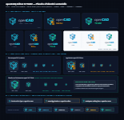

# openCAD brand identity

| Document | Role |
|----------|------|
| [planche-identite.svg](planche-identite.svg) | Vector source (openCAD, Editor & TEAM symbols) |
| [planche-identite-opencad-editor.png](planche-identite-opencad-editor.png) | Raster preview of the board |
| [charte.md](charte.md) | Palette, logo usage, sibling brands |
| [kit/](kit/) | openCAD icons and wordmarks (SVG + key PNG/WebP) |

This repository ships the **openCAD** (formats / platform) mark. Full Editor / TEAM / Sketch kits live in [OpenCadEditor](https://github.com/naanouff/OpenCadEditor).

